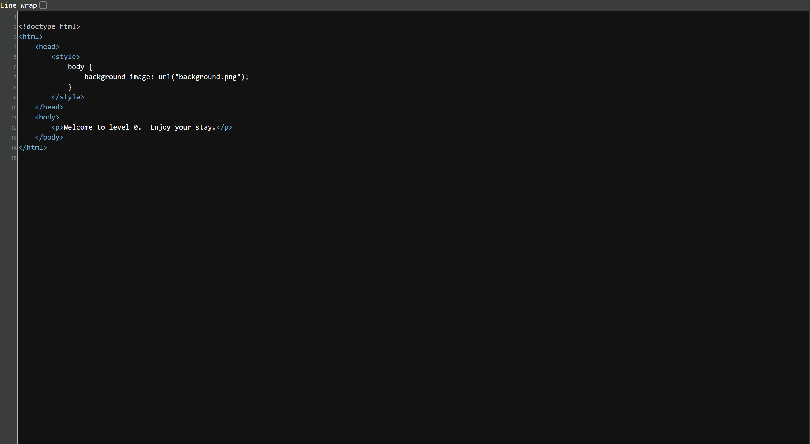
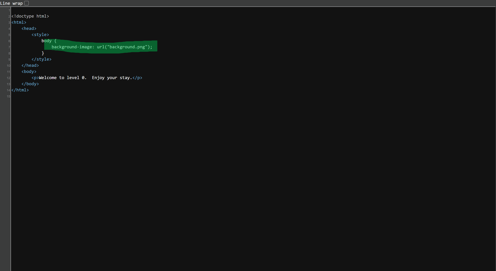

# Info
Difficulty: Trivial

Name: A little something to get you started

Skills: Web

---

# Solution Steps
1) First I take a look at the landing page, and read any information on there.

   

2) I don't see any buttons or any interactive elements on the page, so I go to inspect the page source. Perhaps there is something hidden that isn't immediately visible.

3) In the page source I see an interesting link, it could be interesting to see where it leads.

4) I append the path from the link to the end of the landing page's URL. There I am transported to a new page where the flag is displayed!

